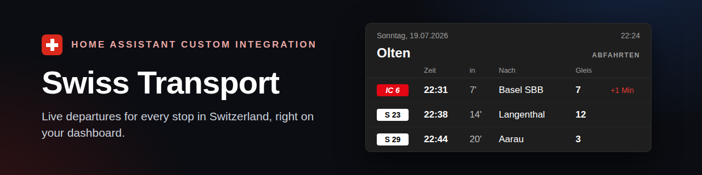
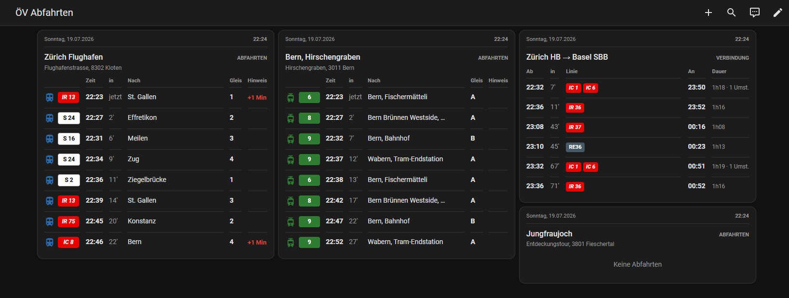

# Swiss Transport



[](https://github.com/hacs/integration)
[](LICENSE)
<a href="https://www.buymeacoffee.com/prusuino"></a>

A Home Assistant custom integration for Swiss public transport, sourced from the free public **transport.opendata.ch** timetable API (backed by search.ch, no account required). Two things it does:

- **Departure boards** — the live Abfahrtstafel of any station (train, tram, bus, ship, cableway).
- **Connections** — a saved route (from → to), e.g. your daily commute, showing the next departures with times, platforms, duration and transfers.
- **Optional real-time** — plug in a free [opentransportdata.swiss](#real-time-optional) token for fresher delays, cancellations, platform changes, disruption messages and occupancy.

Both come with a bundled Lovelace card styled like a station departure board, plus a dashboard strategy that assembles a complete departures dashboard for you.



## What it provides

When you add the integration you first choose a **mode** — a departure board of a station, or a saved connection (from → to). Repeat for as many stations/routes as you like; each becomes its own device.

### Departure board

| Entity | Type | Description |
|---|---|---|
| `sensor.swiss_transport_<station>_<tag>` | Sensor | State = the next departure (timestamp). Attributes: `departures` (the full upcoming board — line, category, destination, platform, delay, operator, departure time, plus `cancelled`/`occupancy` when real-time is enabled), `departure_count`, station name, **address** (reverse-geocoded), coordinates, `realtime` (bool) and `alerts` (disruption messages, real-time only). |

### Connection (from → to)

| Entity | Type | Description |
|---|---|---|
| `sensor.swiss_transport_<from>_<to>_<tag>` | Sensor | State = the next connection's departure (timestamp). Attributes: `connections` (each with departure/arrival time and platform, delay, `duration_min`, `transfers`, the `products`/lines used, and `changes` — the transfer stations with arrival → onward platform), `connection_count`, from/to names and station ids. |

`<station>`, `<from>` and `<to>` are the stop names as the timetable API returns them, slugified; `<tag>` is a short discriminator — the last four characters of the config entry id, lower-cased — that keeps two stops whose names slugify to the same text apart (say the railway station "Zürich HB" and a tram stop "Zürich, HB"). The board of Zürich HB is thus something like `sensor.swiss_transport_zurich_hb_k7q2`, the connection Olten → Zürich HB `sensor.swiss_transport_olten_zurich_hb_m3xz`. The integration suggests these object ids when an entity is first created, so they do not depend on your Home Assistant language — only the entity's displayed name ("Departures" / "Abfahrten") is localized. Entities created by versions before 1.4.0 keep the ids they have (without the tag). Like any entity, they can be renamed in the entity settings afterwards.

Station boards refresh about every 90 seconds. Saved connections refresh every 5 minutes — the transport.opendata.ch API allows only 1000 connection queries per day, and the slower cadence keeps several saved routes comfortably within that quota. If the API ever answers with "too many requests" (HTTP 429), the affected entry pauses for 30 minutes and then resumes automatically.

## Bundled Lovelace cards

The integration ships three cards, all with a visual editor. It serves the card file but does not write to your dashboard configuration — [registering the resource](#1-register-the-card-resource-once) is a short, one-time step.

**`swiss-transport-card`** — a real departure board, laid out like a station display: **symbol · time · countdown · destination · platform · info**, with a live date/time bar on top and an "Abfahrten" label. Colored **line badges** matching the Swiss product scheme (S-Bahn white chip, IC/IR family red, tram/bus/ship/cableway in their mode color) with a transport-mode icon. The platform column is dropped for bus/tram stops; delays show in red. When the optional [real-time source](#real-time-optional) is enabled, cancelled departures are struck through and marked, a disruption banner appears, and an occupancy column is shown when data is available.

```yaml
type: custom:swiss-transport-card
entity: sensor.swiss_transport_<station>_<tag>
title: Zürich HB      # optional
rows: 8               # optional, max departures shown
show_clock: true      # optional, show the date/time bar
show_type: true       # optional, show the "Departures" label
show_occupancy: true  # optional, show the occupancy column (real-time only)
show_alerts: true     # optional, show the disruption banner (real-time only)
max_alerts: 3         # optional, disruptions shown before "+N more" (0 = all)
datetime_entity: datetime.swiss_transport_time  # optional, follow timetable browsing
mode_entity: select.swiss_transport_mode        # optional, follow timetable browsing
```

**`swiss-transport-connection-card`** — a board for a saved route: **departure · platform · countdown · line(s) · arrival · platform · duration/transfers**, with the same date/time bar and a "Verbindung" label. Transfers are listed per connection with the change station and its arrival → onward platform.

```yaml
type: custom:swiss-transport-connection-card
entity: sensor.swiss_transport_<from>_<to>_<tag>
title: Olten → Zürich HB   # optional
datetime_entity: datetime.swiss_transport_time  # optional, follow timetable browsing
mode_entity: select.swiss_transport_mode        # optional, follow timetable browsing
```

**`swiss-transport-controls-card`** — the [timetable browsing](#timetable-browsing-optional) selector bar: a **Live / Departure / Arrival** toggle plus a date/time picker. The [dashboard strategy](#2a-ready-made-dashboard-recommended) puts it at the top, and you can place it on any dashboard yourself:

```yaml
type: custom:swiss-transport-controls-card
```

Both the date/time bar and the type label can be toggled off in the visual editor.

### 1. Register the card resource (once)

1. Go to **Settings → Dashboards → ⋮ (top right) → Resources → + Add resource**. The *Resources* entry is only shown when **Advanced mode** is enabled in your user profile (click your name at the bottom of the sidebar).
2. URL: `/swiss_transport_files/swiss-transport-card.js`
3. Resource type: **JavaScript module**
4. Reload the page.

### 2a. Ready-made dashboard (recommended)

The integration includes a **dashboard strategy** that builds the departures dashboard at display time: the selector bar on top, then one section per station board and saved connection. Nothing is written to your configuration, and a station you add later appears by itself — no dashboard editing.

Create a new empty dashboard (**Settings → Dashboards → + Add dashboard**; the strategy also appears in that dialog), then open **⋮ → Raw configuration editor** and replace its contents with:

```yaml
strategy:
  type: custom:swiss-transport
views: []
```

### Adjusting the strategy

A strategy dashboard has no card editor — the layout is generated fresh on every load. You still have two ways to shape it without giving that up:

**Options.** Anything you add under `strategy:` is passed to the recipe:

```yaml
strategy:
  type: custom:swiss-transport
  title: My title
  max_columns: 3
views: []
```

| Option | Effect |
|---|---|
| `title` | dashboard title |
| `max_columns` | column count of the generated section views |

**One view inside your own dashboard.** Instead of a separate dashboard, let the strategy fill a single view of one you already have. Open your dashboard's raw configuration editor and add a view:

```yaml
views:
  - title: Home
    # ... your own cards ...
  - title: Swiss Transport
    strategy:
      type: custom:swiss-transport
```

That view is regenerated like the full dashboard is, so new config entries still appear by themselves, while every other view stays yours to edit. The same options work here too.

> **Take control** (⋮ menu) turns a strategy dashboard into a static one you can edit card by card — but it is one-way: the dashboard stops following your config entries from then on. Prefer the two approaches above.

### 2b. Or build the cards yourself

Take the YAML blocks above and place the cards on any dashboard you like — the strategy is a convenience, not a requirement. Replace the entity IDs with your own — they are built from the stop names plus a short tag (see [What it provides](#what-it-provides)), not from the localized entity name.

> **After updating the integration:** the card file is served without cache headers, so a browser reload picks up the new version and your resource URL never has to change. If a new card feature still does not show up, do a hard reload (Ctrl+F5 / Cmd+Shift+R).

## Options

Via the integration's Configure dialog you can change the **number of departures/connections**, and for a station board restrict the **transport types** shown (train / tram / bus / ship / cableway). Changes apply immediately.

## Timetable browsing (optional)

Every board can be switched from the live view to **any date and time** — e.g. "which trains leave tomorrow at 07:00?" or "what arrives before my meeting?". The integration creates two helper entities for this — once, shared by every station board and saved connection you add (a second entry does not get its own pair), with these fixed entity ids:

| Entity | Purpose |
|---|---|
| `datetime.swiss_transport_time` | The date/time to browse |
| `select.swiss_transport_mode` | `live` (default), `depart` (departures at the selected time) or `arrive` (**arrivals** by the selected time) |

The dashboard strategy puts a selector bar (`swiss-transport-controls-card`) at the top; changing it switches **all** cards on the dashboard at once. Cards you added manually follow along as soon as their `datetime_entity`/`mode_entity` options point at the two helpers (visual editor: "Date/time entity" / "Mode entity").

What the cards show:

- **Departure mode** — the station board / connections from the selected time, with a blue "Timetable: …" banner.
- **Arrival mode** — station boards flip to an **arrivals board**: the label changes to "Ankünfte"/"Arrivals" and the direction column changes from *Nach/To* to *Von/From*, showing where each service comes from. Connection cards interpret the selected time as the **latest arrival**.
- **Live** — back to the normal live board.

Timetable data is fetched by your browser directly from transport.opendata.ch. In timetable mode boards show the planned schedule only — real-time delays, cancellations and disruption messages apply to the live view.

## Real-time (optional)

By default all data — including delays — comes from transport.opendata.ch, which reports delays but not reliably cancellations. You can **optionally** enrich station boards with the official **Open Journey Planner (OJP 2.0)** real-time feed from [opentransportdata.swiss](https://opentransportdata.swiss/), which adds:

- **fresher, second-accurate delays**,
- **cancellations** (struck-through and marked on the board),
- **platform changes**,
- **disruption messages** (shown as a banner), and
- **occupancy** forecasts (shown as a column when available).

This is completely optional. Without a token nothing changes and everything keeps working from transport.opendata.ch.

### Getting a token (free)

The token is free. On [opentransportdata.swiss](https://opentransportdata.swiss/) → **API Manager**:

1. Log in (create an account if needed).
2. Choose the **OJP 2.0** API and open it.
3. Click **Access with this plan** and select (or create) an app — give it a name and description.
4. Open the app under **my apps** and copy the **TOKEN** (the *Token Hash* is **not** needed).

The current OJP 2.0 plan allows 20 000 calls/day and 50 calls/minute — far more than this integration needs (it makes one call per station per ~90 s refresh).

### Enabling it

Paste the token into the **Real-time token** field when adding a station, or later via the station's **Configure** dialog. Entered once, it enriches **every** station board. Leave it empty to use transport.opendata.ch only.

> Note: the token is a credential — treat it like a password. It is stored in Home Assistant like any other integration secret and never leaves your instance except in requests to opentransportdata.swiss.

## Language

Entity names and card labels follow your Home Assistant language — German, English, French, and Italian, with English as the fallback.

## Installation

### HACS (recommended)

1. Open **HACS**, search for **"Swiss Transport"** and download it — or use the button, which opens the integration directly in your HACS:

   [](https://my.home-assistant.io/redirect/hacs_repository/?owner=prusuino&repository=ha_swiss_transport&category=integration)

2. Restart Home Assistant.

The integration is listed in the HACS default store, so no custom repository is needed.

### Manual

1. Copy the `custom_components/swiss_transport` folder into your Home Assistant `config/custom_components/` directory.
2. Restart Home Assistant.

## Setup

1. **Settings → Devices & Services → Add Integration**, search for **"Swiss Transport"**.
2. Choose a mode:
   - **Departure board** — type part of a station name (e.g. "Bern", "Zürich HB", "Luzern, Bahnhof"), pick the exact stop, set how many departures to show, optionally limit the transport types.
   - **Connection (from → to)** — type both station names, pick the exact stops, set how many connections to show. Great for a daily commute (add the reverse direction as a second connection for the way back).
3. Done — add the integration again for another station or route.

## Notes

- Only relevant for stops within Switzerland (and directly connected cross-border stations covered by the Swiss timetable).
- transport.opendata.ch is a free community service with daily rate limits (1000 connection queries, 10080 station board queries per day) — the integration polls conservatively (station boards ~90 s, saved connections ~5 min) and backs off automatically after an HTTP 429. Note that the cards' timetable-browsing mode queries the API directly from your browser and counts towards the same per-IP quota. Without the optional real-time source, delays depend on that feed's own reporting and cancellations are not shown.
- Since the DST change on 2026-10-25 the `/stationboard` endpoint of transport.opendata.ch has been serving departure boards one hour late (connections are not affected; reported as [OpendataCH/Transport#224](https://github.com/OpendataCH/Transport/issues/224)). Version 1.4.1 works around this: when a board's first row is more than 45 minutes ahead, the integration and the card ask once more for the window one hour earlier and drop the rows that have already left. Once the API is correct again the extra request simply returns the same rows, so nothing changes for you.
- Unofficial; not affiliated with Opendata.ch, search.ch, opentransportdata.swiss, OpenStreetMap, or any transport operator.

## Data source & license

Source code: MIT — see [LICENSE](LICENSE). Data sources and their required attribution — timetable & departures from transport.opendata.ch (search.ch), optional real-time from opentransportdata.swiss (OJP), and station addresses from OpenStreetMap contributors (ODbL) — are documented in [NOTICE.md](NOTICE.md). Every entity sets Home Assistant's `attribution` attribute to credit the sources actually used.

## Disclaimer

This integration is provided **as-is, without any warranty**. Timetable and real-time data come from a third-party service and may be inaccurate, delayed, incomplete, or unavailable. Do not rely on it as your sole source for catching a connection — always check official displays. The author(s) accept **no responsibility or liability** for any missed connection, damage, or loss arising from using this integration.

## Related integrations

More Home Assistant integrations from the same author:

- [Swiss Waters](https://github.com/prusuino/ha_swiss_waters) — live water temperature, water level, discharge and flood danger levels of Swiss rivers and lakes
- [Swiss Charging Stations](https://github.com/prusuino/ha_swiss_charging_stations) — real-time availability and prices of public EV charging stations in Switzerland
- [Austrian Charging Stations](https://github.com/prusuino/ha_austrian_charging_stations) — real-time availability of public EV charging stations in Austria
- [Swiss Parking](https://github.com/prusuino/ha_swiss_parking) — live free parking spaces in Swiss cities
- [Swiss Electricity Price](https://github.com/prusuino/ha_swiss_electricity_price) — electricity tariffs of any Swiss grid operator (ElCom)
- [Swiss Solar Reference Price](https://github.com/prusuino/ha_swiss_solar_reference_price) — the Swiss solar reference market price (SFOE)
- [Swiss Earthquakes](https://github.com/prusuino/ha_swiss_earthquakes) — recent Swiss earthquakes on the built-in map
- [Swiss Public Alerts](https://github.com/prusuino/ha_swiss_public_alerts) — official Swiss public alerts (Alertswiss) with home-location matching
- [Swiss Avalanche Bulletin](https://github.com/prusuino/ha_swiss_avalanche_bulletin) — the official SLF avalanche bulletin for your location
- [Innoxel Master 3](https://github.com/prusuino/ha_innoxel_master3) — local control of the Innoxel Master 3 home-automation system
- [Swiss Hail Protection](https://github.com/prusuino/ha_swiss_hail_protection) — Swiss hail warnings for your blinds: the official VKF hail-protection signal or the MeteoSwiss hail radar around your location

## Support

If this integration is useful to you, you can support its development:

<a href="https://www.buymeacoffee.com/prusuino"></a>
